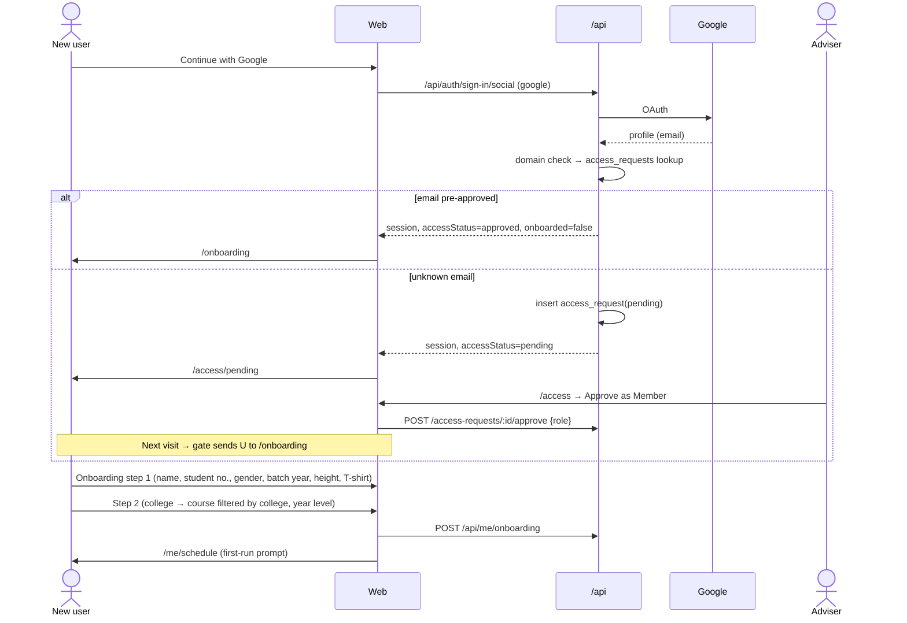
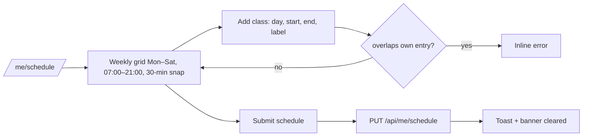
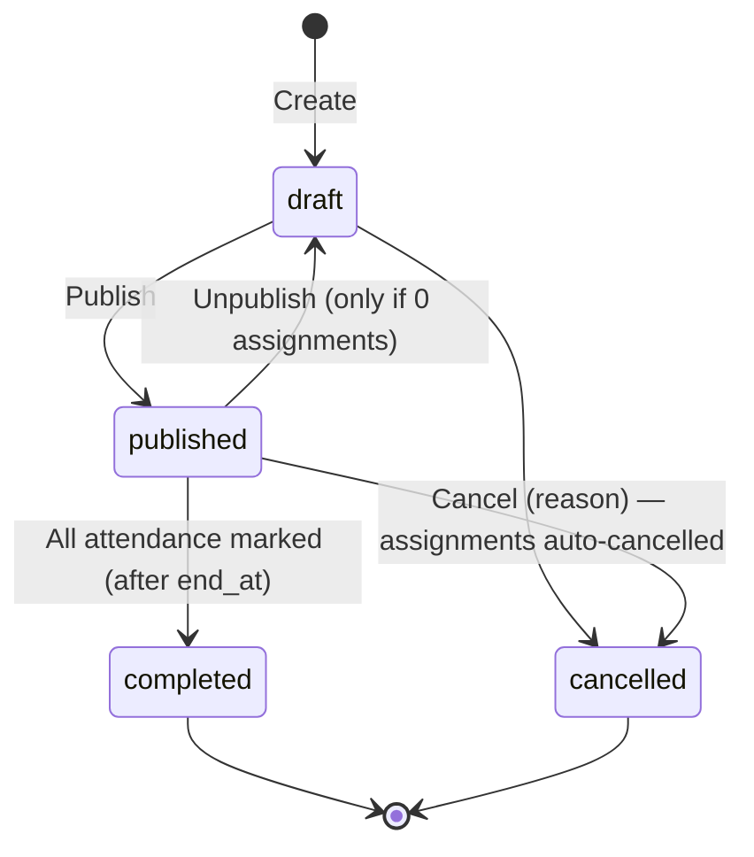
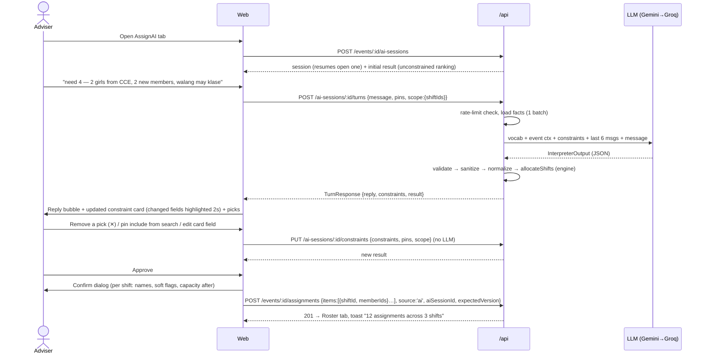

# UMAL Management — App Flow Document

| | |
|---|---|
| **Version** | 2.0 · Draft · 2026-11-10 |
| **Depends on** | [PRD](01-product-requirements.md) · [TRD](02-technical-requirements.md) |

Routes are static-export pages. Dynamic records use query params (`?id=`). Every page reads `/api/me` through the `AppGate` component, which redirects by access state before rendering.

---

## 1. Entry gate (every page)

```mermaid
flowchart TD
  A[Open any URL] --> B{GET /api/me}
  B -- 401 no session --> L[/login/]
  B -- accessStatus=pending --> P[/access/pending/]
  B -- accessStatus=rejected --> R[/access/rejected/]
  B -- approved, not onboarded --> O[/onboarding/]
  B -- onboarded --> C{role}
  C -- member --> M[/me/ — Member home]
  C -- adviser --> D[/dashboard/ — Adviser home]
  M -. scheduleSubmitted=false .-> S[Banner: Submit your class schedule → /me/schedule]
```

- `AppGate` shows a full-page skeleton while `/api/me` loads, so pages never flash.
- If a member visits an adviser-only route, they get a 403 page with a link home. The API enforces the same rule regardless.

## 2. Screen inventory

| Route | Who | Purpose |
|---|---|---|
| `/login` | public | UMAL brand panel + "Continue with Google" |
| `/access/pending` | pending | "Your request was sent to UMAL advisers." Shows email, sign out |
| `/access/rejected` | rejected | Message + earliest re-request date |
| `/onboarding` | approved, not onboarded | 2-step form: Personal → Academic. Then redirect to `/me/schedule` |
| `/me` | member | Upcoming shifts, term stats (hours served, shifts, attendance), schedule status, published events |
| `/me/schedule` | member | Weekly class grid editor for the active term + Submit |
| `/me/availability` | member | Unavailability blocks (weekly / specific date) |
| `/me/history` | member | Past shifts with hours and attendance |
| `/me/profile` | all | Edit own profile |
| `/dashboard` | adviser | Pending access count, upcoming events needing staff, events needing attendance, missing-schedules count, AI health |
| `/events` | all (members: published/completed only) | List with filters (status, month), overall staffing progress bars, shift count |
| `/events/new` | adviser | Create event form with shifts editor |
| `/events/view?id=` | all | Event detail. Adviser tabs: **Roster** · **AssignAI** · **Attendance** · **Activity** |
| `/events/edit?id=` | adviser | Edit event |
| `/members` | adviser | Directory with filters (college, year, role, status, schedule submitted) |
| `/members/view?id=` | adviser | Profile, term stats, assignment history, role/status actions |
| `/access` | adviser | Access queue: Pending · Approved · Rejected · **Bulk pre-approve** |
| `/reports/fairness` | adviser | Term selector, metrics, distribution chart, never-assigned list, CSV |
| `/audit` | adviser | Filterable log |
| `/settings` | adviser | General · Terms · Colleges & Courses · Scoring · AI |

**Navigation**
- **Advisers:** left sidebar (desktop) or bottom sheet menu (mobile) with Dashboard, Events, Members, Access (badge = pending count), Reports, Audit, Settings.
- **Members:** top bar with Home, My Schedule, Availability, History, Events.

## 3. Access and onboarding



**Validation and edge cases**
- Student number must be unique; a duplicate shows an inline error: "Already registered, contact an adviser".
- Course choices are filtered by the selected college.
- Height must be 100–230 cm.
- Bulk pre-approve accepts pasted text (one email per line, commas allowed) or a CSV with an `email` column. The preview shows new, already-approved and invalid counts before confirming.

## 4. Member: schedule and availability



- On mobile the grid is a list grouped by day, with an "Add class" sheet.
- Copy from the previous term is available when the previous term's schedule exists.
- The schedule can be edited all term. Each save replaces the whole set. Future assignments that now conflict appear on the adviser's dashboard as **"⚠ New conflicts (n)"**.
- In `/me/availability`, the user adds a block, picks Weekly (day + time range) or Specific date (date + time range, or "whole day" = 00:00–24:00), and adds an optional reason.

## 5. Event lifecycle



- **Event form → Schedule section**, with three ways to set shifts:
  - **Single block** (default): one start and one end (date + time), plus volunteers needed. This creates one shift labelled "Main". If the end is on a later date, a hint reads "Crosses midnight".
  - **Daily block**: date range + daily start/end time + volunteers per day, e.g. 13–15 Nov, 08:00–17:00, 6 per day. This creates shifts "Day 1…3" via `POST /events/:id/shifts/daily`.
  - **Custom shifts**: an editable table (label, start, end, volunteers) with **Add shift**, for things like "Day 1 AM / Day 1 PM".
- Validation:
  - end after start
  - each shift ≤ 24 h
  - whole event ≤ 14 days
  - a shift with volunteers can't be removed or moved (409 `SHIFT_HAS_ASSIGNMENTS` → "Cancel its 3 volunteers first")
- Lists and cards show the event span (`13–15 Nov · 3 shifts`) and the overall staffing `14 / 18`. Event detail shows each shift's staffing bar.
- The candidate dialog explains a conflict by day, e.g. "⚠ Class conflict on Sat 14 Nov".
- Assignments can be created only on shifts that haven't ended, while the event is `draft` or `published`.
- Attendance for a shift is enabled once `now ≥ shift.end_at` (Asia/Manila).
- Editing an empty shift's times re-checks nothing (no volunteers yet). Editing event details never touches shifts with volunteers.

## 6. Manual assignment (Roster tab)

1. The roster is grouped by shift. On a shift, the adviser clicks **Add volunteers**, which opens a dialog listing candidates from `GET /events/:id/candidates?shiftId=&search=`. A shift switcher in the dialog lets them move to the next shift without closing it.
2. Each row shows the name, college, year and term load, plus a badge: ✅ Eligible · ⚠ Class conflict · ⛔ Unavailable / Double-booked / Already added / Schedule missing.
3. ⛔ rows are disabled. Selecting a ⚠ row reveals an "Override class conflict" checkbox for that row.
4. **Add** → `POST /events/:id/assignments {items:[{shiftId, memberIds, overrideConflictIds}], source:'manual', expectedVersion}`.
   - 409 `VERSION_CONFLICT` → toast "Roster changed by someone else", then auto-refresh.
   - 409 `OVER_CAPACITY` → inline error showing the remaining slots.
5. Remove (⋯ menu) → dialog asking for a reason → `POST /assignments/:id/cancel`.

## 7. AssignAI (core flow)

### 7.1 Layout
- **Shift scope bar** across the top (only shown when the event has more than one shift): chips for each shift plus **All shifts**. The default is all shifts that still have open slots. With more than one shift selected, a **Team mode** toggle appears: *Same team for all* / *Different per shift*. The AI can also set it from text like "same 5 people all 3 days".
- **Desktop:** below the bar, the tab is split into **Chat** (left, 40%) and **Constraints card + Recommendations** (right, 60%).
- **Mobile:** it's a full-screen sheet with segmented control Chat | Picks; the scope bar scrolls horizontally.

### 7.2 Turn loop



### 7.3 Turn outcomes and UI

| `kind` | UI behaviour |
|---|---|
| `update` | Reply bubble. The card animates changed fields. Picks refresh. `assumptions` show as small "Assumed: …" chips under the reply. |
| `clarify` | Reply bubble with a question. Suggested quick replies appear when the server provides them (e.g. college choices). Picks don't change. |
| `answer` | Reply bubble only. |
| `confirm_request` | Reply "Review the picks and press **Approve** to assign." The Approve button pulses once. **No write happens.** |
| provider `none` | Amber inline notice: "AI unavailable. You can still edit constraints directly." The card stays editable. |

### 7.4 Recommendations panel
- A header shows `n of required` (summed over shifts in scope) and remaining slots after approval, with an **Approve (n)** primary button.
- With more than one shift, picks are shown per shift in collapsible sections ("Day 1 · Fri 13 Nov 08:00–17:00 · 6/6"). In **same team** mode, one list shows with a note "Assigned to all 3 shifts".
- Within a shift, picks are grouped by group: "Group 1 · 2 × Female · CCE". Each pick card shows:
  - name, college, year, hours served this term
  - a score bar
  - an expandable "Why" section: hours vs average, days since last, reliability, matched filters
  - soft flags
  - ✕ remove, which adds a pin-exclude
- A **Shortfall** callout per unfilled group: "Need 2, found 1. Allow any college → +5". The button applies the relaxation to the card.
- A collapsed **Excluded (n)** summary lists counts by reason, e.g. Class conflict 7 · Unavailable 3 · Double-booked 1.
- **Add someone specific:** a member search that pins an include. That member must still be eligible, otherwise an inline reason is shown.

### 7.5 Error states

| Condition | UI |
|---|---|
| 429 `AI_RATE_LIMITED` | Inline notice with the reset time; manual editing still works |
| 422 `INELIGIBLE` on approve | Dialog listing members and reasons, with "Remove them and approve the rest" |
| 409 `VERSION_CONFLICT` | Refresh the roster and re-run the current constraints, then let the adviser re-approve |
| 409 `OVER_CAPACITY` | Show remaining slots; ask to deselect |
| Network/5xx | Retry button on the turn; the message stays in the input |

## 8. Attendance

1. The Attendance tab lists assignments grouped by shift. A shift's rows become editable once that shift has ended, with a segmented control: Attended · No-show · Excused.
2. "Mark all attended" is available per shift, then exceptions can be adjusted.
3. **Save** → `PUT /events/:id/attendance`. When every shift has ended and every non-cancelled assignment is marked, the event becomes `completed` and a success toast appears.
4. Corrections are allowed later. Each change is audited.

## 9. Reports and audit

- **Fairness report:**
  - term picker at the top
  - KPI row: Members eligible, Hours served (total and average), Gini of hours, Top-10% share, Never assigned, No-show rate, AI share, Override rate
  - histogram of hours per member
  - table sortable by hours (and shift count), with a never-assigned filter
  - **Export CSV**
- **Audit:** table (time, actor, action, entity, details JSON drawer) with filters and pagination.

## 10. Settings

| Tab | Contents |
|---|---|
| General | Allowed email domain (default `umindanao.edu.ph`; blank = any), `assignment.requireSchedule`, school-year start month (default 8 = August) |
| Terms | List, create, edit dates, **Activate** (confirm dialog: "Members will be asked to submit schedules for this term") |
| Colleges & Courses | Table with code, name, active; course sub-table per college |
| Scoring | Weights for load, recency and reliability (0–10, step 0.5), the load unit in hours (default 4), and a live preview of the top 10 for a chosen upcoming shift |
| AI | Turns per hour per user, provider status (last error, p50 latency from `ai_turns`) |

## 11. Empty and first-run states

| Screen | Empty state |
|---|---|
| Dashboard (no active term) | "Create and activate a term to start" → Settings › Terms |
| Events | "No events yet" + Create event |
| AssignAI (0 eligible) | "No one is eligible for this time slot." Shows the top exclusion reasons and links to the Members page filtered by "Schedule missing" |
| Member home (no assignments) | "No assignments yet. Make sure your schedule and availability are up to date." |
