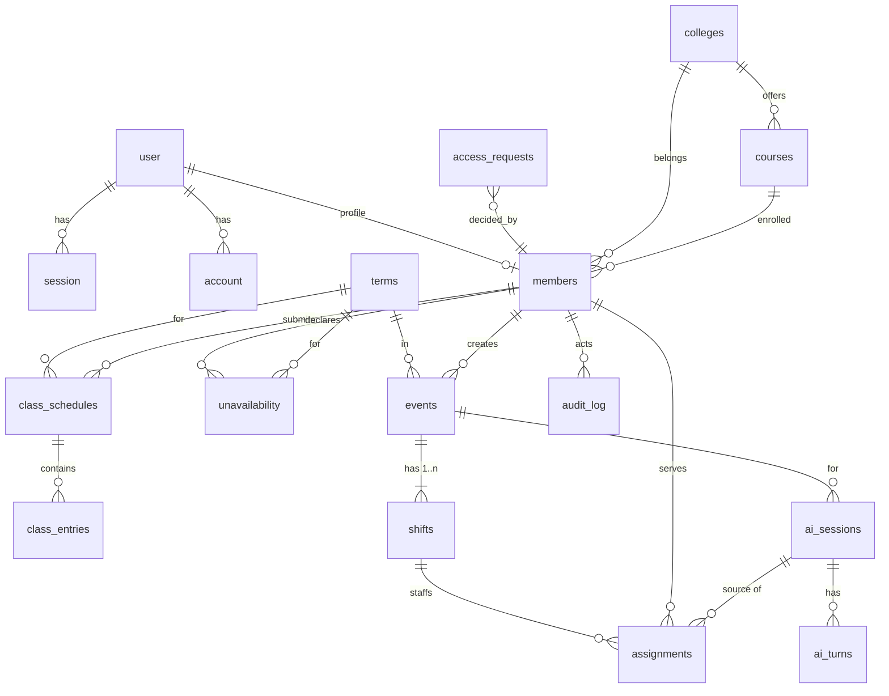

# UMAL Management — Backend Schema

| | |
|---|---|
| **Version** | 2.0 · Draft · 2026-11-10 |
| **Database** | Cloudflare D1 (SQLite). Defined in Drizzle (`server/db/schema.ts`); SQL generated by drizzle-kit into `migrations/` |
| **Depends on** | [TRD](02-technical-requirements.md) §5, §8 |

---

## 1. Conventions

- **Primary keys:** `INTEGER PRIMARY KEY AUTOINCREMENT` for app tables. Better Auth tables use `TEXT` ids, which it generates.
- **Timestamps:** `TEXT` ISO-8601 UTC (`2026-11-10T13:05:00.000Z`) for audit and creation times.
- **Local times:** event and schedule values are local Asia/Manila strings (zero-padded, so lexicographic order = time order):
  - event and shift `start_at`/`end_at` = `YYYY-MM-DDTHH:MM`
  - schedule `start_time`/`end_time` = `HH:MM` (24 h); `end_time` may be `'24:00'` to mean end of day
  - `date` = `YYYY-MM-DD`
- **Weekdays:** `day_of_week` is ISO, 1 = Monday … 7 = Sunday.
- **Enums:** `TEXT` with `CHECK (... IN (...))`; the same values are mirrored in `shared/enums.ts`.
- **Deletes:** no hard deletes for domain data. Use `status` or `active` flags. FKs use `ON DELETE RESTRICT` unless noted.
- **Foreign keys:** D1 enforces them by default (`PRAGMA foreign_keys = ON`).
- **Booleans:** `INTEGER` 0/1.

## 2. Entity relationship overview



## 3. Auth tables (generated by Better Auth)

Generated with `npx @better-auth/cli generate --config server/auth.ts` into `server/db/auth-schema.ts`, then merged into the Drizzle schema. Don't hand-edit them.

| Table | Key columns |
|---|---|
| `user` | `id TEXT PK`, `name`, `email UNIQUE`, `emailVerified`, `image`, `createdAt`, `updatedAt` |
| `session` | `id`, `token UNIQUE`, `userId → user.id ON DELETE CASCADE`, `expiresAt`, `ipAddress`, `userAgent` |
| `account` | `id`, `userId → user.id`, `providerId` (`google`), `accountId`, tokens, `scope` |
| `verification` | `id`, `identifier`, `value`, `expiresAt` |

## 4. Application tables (DDL)

```sql
-- ── Catalog ────────────────────────────────────────────────────────────────
CREATE TABLE colleges (
  id          INTEGER PRIMARY KEY AUTOINCREMENT,
  code        TEXT NOT NULL UNIQUE,              -- 'CCE'
  name        TEXT NOT NULL,                     -- 'College of Computing Education'
  active      INTEGER NOT NULL DEFAULT 1,
  created_at  TEXT NOT NULL
);

CREATE TABLE courses (
  id          INTEGER PRIMARY KEY AUTOINCREMENT,
  college_id  INTEGER NOT NULL REFERENCES colleges(id),
  code        TEXT NOT NULL,                     -- 'BSCS'
  name        TEXT NOT NULL,
  active      INTEGER NOT NULL DEFAULT 1,
  created_at  TEXT NOT NULL,
  UNIQUE (college_id, code)
);

CREATE TABLE terms (
  id          INTEGER PRIMARY KEY AUTOINCREMENT,
  name        TEXT NOT NULL UNIQUE,              -- '1st Semester AY 2026–2027'
  start_date  TEXT NOT NULL,
  end_date    TEXT NOT NULL,
  is_active   INTEGER NOT NULL DEFAULT 0,
  created_at  TEXT NOT NULL,
  CHECK (start_date < end_date)
);
CREATE UNIQUE INDEX terms_one_active ON terms(is_active) WHERE is_active = 1;

-- ── Access & people ───────────────────────────────────────────────────────
CREATE TABLE access_requests (
  id            INTEGER PRIMARY KEY AUTOINCREMENT,
  email         TEXT NOT NULL UNIQUE COLLATE NOCASE,
  status        TEXT NOT NULL DEFAULT 'pending' CHECK (status IN ('pending','approved','rejected')),
  role          TEXT NOT NULL DEFAULT 'member' CHECK (role IN ('member','adviser')),
  source        TEXT NOT NULL CHECK (source IN ('sign_in','bulk')),
  decided_by    INTEGER REFERENCES members(id),
  decided_at    TEXT,
  note          TEXT,
  created_at    TEXT NOT NULL
);
CREATE INDEX access_requests_status ON access_requests(status, created_at);

CREATE TABLE members (
  id              INTEGER PRIMARY KEY AUTOINCREMENT,
  user_id         TEXT NOT NULL UNIQUE REFERENCES user(id),
  email           TEXT NOT NULL UNIQUE COLLATE NOCASE,
  role            TEXT NOT NULL CHECK (role IN ('member','adviser')),
  status          TEXT NOT NULL DEFAULT 'active' CHECK (status IN ('active','inactive')),
  first_name      TEXT,
  last_name       TEXT,
  student_number  TEXT UNIQUE,
  gender          TEXT CHECK (gender IN ('M','F')),
  college_id      INTEGER REFERENCES colleges(id),
  course_id       INTEGER REFERENCES courses(id),
  year_level      INTEGER CHECK (year_level BETWEEN 1 AND 5),
  batch_year      INTEGER CHECK (batch_year BETWEEN 2000 AND 2100),  -- school-year start of joining
  height_cm       INTEGER CHECK (height_cm BETWEEN 100 AND 230),
  tshirt_size     TEXT CHECK (tshirt_size IN ('XS','S','M','L','XL','2XL','3XL')),
  onboarded_at    TEXT,                          -- NULL until onboarding complete
  created_at      TEXT NOT NULL,
  updated_at      TEXT NOT NULL
);
CREATE INDEX members_role_status ON members(role, status);
CREATE INDEX members_college ON members(college_id);

-- ── Schedules & availability ──────────────────────────────────────────────
CREATE TABLE class_schedules (
  id            INTEGER PRIMARY KEY AUTOINCREMENT,
  member_id     INTEGER NOT NULL REFERENCES members(id),
  term_id       INTEGER NOT NULL REFERENCES terms(id),
  submitted_at  TEXT NOT NULL,
  updated_at    TEXT NOT NULL,
  UNIQUE (member_id, term_id)
);

CREATE TABLE class_entries (
  id            INTEGER PRIMARY KEY AUTOINCREMENT,
  schedule_id   INTEGER NOT NULL REFERENCES class_schedules(id) ON DELETE CASCADE,
  day_of_week   INTEGER NOT NULL CHECK (day_of_week BETWEEN 1 AND 7),
  start_time    TEXT NOT NULL,
  end_time      TEXT NOT NULL,
  label         TEXT,                            -- 'CS 311 Lec'
  CHECK (start_time < end_time)
);
CREATE INDEX class_entries_schedule_day ON class_entries(schedule_id, day_of_week);

CREATE TABLE unavailability (
  id            INTEGER PRIMARY KEY AUTOINCREMENT,
  member_id     INTEGER NOT NULL REFERENCES members(id),
  term_id       INTEGER NOT NULL REFERENCES terms(id),
  kind          TEXT NOT NULL CHECK (kind IN ('weekly','date')),
  day_of_week   INTEGER CHECK (day_of_week BETWEEN 1 AND 7),
  date          TEXT,
  start_time    TEXT NOT NULL,
  end_time      TEXT NOT NULL,                   -- may be '24:00' (whole day = 00:00–24:00)
  reason        TEXT,
  created_at    TEXT NOT NULL,
  CHECK (start_time < end_time),
  CHECK ((kind = 'weekly' AND day_of_week IS NOT NULL AND date IS NULL)
      OR (kind = 'date'   AND date IS NOT NULL AND day_of_week IS NULL))
);
CREATE INDEX unavailability_member_term ON unavailability(member_id, term_id);
CREATE INDEX unavailability_date ON unavailability(date) WHERE kind = 'date';

-- ── Events & assignments ──────────────────────────────────────────────────
CREATE TABLE events (
  id                   INTEGER PRIMARY KEY AUTOINCREMENT,
  term_id              INTEGER NOT NULL REFERENCES terms(id),   -- term whose dates contain date(start_at)
  title                TEXT NOT NULL,
  description          TEXT,
  venue                TEXT,
  start_at             TEXT NOT NULL,               -- derived: MIN(shifts.start_at), maintained by code
  end_at               TEXT NOT NULL,               -- derived: MAX(shifts.end_at); may be a later date
  status               TEXT NOT NULL DEFAULT 'draft'
                         CHECK (status IN ('draft','published','completed','cancelled')),
  cancel_reason        TEXT,
  version              INTEGER NOT NULL DEFAULT 0,   -- bumped on every roster/attendance/event change
  created_by           INTEGER NOT NULL REFERENCES members(id),
  created_at           TEXT NOT NULL,
  updated_at           TEXT NOT NULL,
  CHECK (start_at < end_at)                          -- span ≤ 14 days enforced in code
);
CREATE INDEX events_start ON events(start_at);
CREATE INDEX events_end ON events(end_at);
CREATE INDEX events_term_status ON events(term_id, status);

-- Every event has ≥ 1 shift. A simple event has exactly one shift covering the whole event.
-- Volunteers are assigned to shifts. One member may hold several non-overlapping shifts of the same event.
CREATE TABLE shifts (
  id                   INTEGER PRIMARY KEY AUTOINCREMENT,
  event_id             INTEGER NOT NULL REFERENCES events(id),
  label                TEXT NOT NULL,               -- 'Main', 'Day 1', 'Day 2 PM'
  start_at             TEXT NOT NULL,               -- 'YYYY-MM-DDTHH:MM' local; may cross midnight
  end_at               TEXT NOT NULL,
  required_volunteers  INTEGER NOT NULL CHECK (required_volunteers BETWEEN 1 AND 200),
  position             INTEGER NOT NULL,            -- display order (chronological by default)
  active               INTEGER NOT NULL DEFAULT 1,  -- 0 = removed (only allowed with no active assignments)
  created_at           TEXT NOT NULL,
  updated_at           TEXT NOT NULL,
  CHECK (start_at < end_at),                        -- duration ≤ 24 h enforced in code
  UNIQUE (event_id, label)
);
CREATE INDEX shifts_event ON shifts(event_id, position);
CREATE INDEX shifts_time ON shifts(start_at, end_at);

CREATE TABLE assignments (
  id                    INTEGER PRIMARY KEY AUTOINCREMENT,
  event_id              INTEGER NOT NULL REFERENCES events(id),   -- denormalized from shift for queries
  shift_id              INTEGER NOT NULL REFERENCES shifts(id),
  member_id             INTEGER NOT NULL REFERENCES members(id),
  status                TEXT NOT NULL DEFAULT 'assigned'
                          CHECK (status IN ('assigned','attended','no_show','excused','cancelled')),
  source                TEXT NOT NULL CHECK (source IN ('ai','manual')),
  ai_session_id         INTEGER REFERENCES ai_sessions(id),
  conflict_override     INTEGER NOT NULL DEFAULT 0,   -- 1 = assigned despite CLASS_CONFLICT
  assigned_by           INTEGER NOT NULL REFERENCES members(id),
  assigned_at           TEXT NOT NULL,
  attendance_marked_by  INTEGER REFERENCES members(id),
  attendance_marked_at  TEXT,
  cancelled_by          INTEGER REFERENCES members(id),
  cancelled_at          TEXT,
  cancel_reason         TEXT,
  CHECK (status <> 'cancelled' OR (cancelled_at IS NOT NULL AND cancel_reason IS NOT NULL)),
  CHECK (source <> 'ai' OR ai_session_id IS NOT NULL)
);
CREATE UNIQUE INDEX assignments_one_active
  ON assignments(shift_id, member_id) WHERE status <> 'cancelled';
CREATE INDEX assignments_member_status ON assignments(member_id, status);
CREATE INDEX assignments_event ON assignments(event_id, status);
CREATE INDEX assignments_shift ON assignments(shift_id, status);

-- Optimistic-concurrency guard used inside D1 batches (TRD §8.5). Always empty after a batch.
CREATE TABLE write_guards (
  ok INTEGER NOT NULL CHECK (ok = 1)
);

-- ── AssignAI ──────────────────────────────────────────────────────────────
CREATE TABLE ai_sessions (
  id                 INTEGER PRIMARY KEY AUTOINCREMENT,
  event_id           INTEGER NOT NULL REFERENCES events(id),
  created_by         INTEGER NOT NULL REFERENCES members(id),
  status             TEXT NOT NULL DEFAULT 'open' CHECK (status IN ('open','approved','abandoned')),
  constraints_json   TEXT NOT NULL,               -- current Constraints (shared/constraints.ts)
  pins_json          TEXT NOT NULL DEFAULT '{"include":[],"exclude":[]}',
  scope_json         TEXT NOT NULL,               -- {"shiftIds":[…]} the shifts this session is staffing
  last_result_json   TEXT,                        -- last ShiftsAllocation (picks only: shiftId + memberId + groupIndex + score)
  outcome_json       TEXT,                        -- on approve: {recommended, approved, accepted, removed, added}: arrays of [shiftId, memberId]
  created_at         TEXT NOT NULL,
  updated_at         TEXT NOT NULL
);
CREATE UNIQUE INDEX ai_sessions_one_open ON ai_sessions(event_id, created_by) WHERE status = 'open';

CREATE TABLE ai_turns (
  id                 INTEGER PRIMARY KEY AUTOINCREMENT,
  session_id         INTEGER NOT NULL REFERENCES ai_sessions(id),
  created_by         INTEGER NOT NULL REFERENCES members(id),   -- denormalized for rate limiting
  kind               TEXT NOT NULL CHECK (kind IN ('update','answer','clarify','confirm_request','manual_edit')),
  user_message       TEXT,                        -- NULL for manual_edit
  reply              TEXT,
  assumptions_json   TEXT NOT NULL DEFAULT '[]',
  constraints_json   TEXT NOT NULL,               -- state AFTER this turn
  provider           TEXT NOT NULL CHECK (provider IN ('gemini','groq','none')),
  model              TEXT,
  latency_ms         INTEGER,
  error              TEXT,
  created_at         TEXT NOT NULL
);
CREATE INDEX ai_turns_session ON ai_turns(session_id, id);
CREATE INDEX ai_turns_rate ON ai_turns(created_by, created_at);

-- ── Audit & settings ──────────────────────────────────────────────────────
CREATE TABLE audit_log (
  id            INTEGER PRIMARY KEY AUTOINCREMENT,
  actor_id      INTEGER REFERENCES members(id),   -- NULL = system
  action        TEXT NOT NULL,                    -- see §5
  entity_type   TEXT NOT NULL,                    -- 'event' | 'assignment' | 'member' | 'access_request' | 'term' | 'settings' | 'catalog'
  entity_id     INTEGER,
  data_json     TEXT NOT NULL DEFAULT '{}',
  created_at    TEXT NOT NULL
);
CREATE INDEX audit_entity ON audit_log(entity_type, entity_id);
CREATE INDEX audit_actor_time ON audit_log(actor_id, created_at);
CREATE INDEX audit_time ON audit_log(created_at);

CREATE TABLE settings (
  key          TEXT PRIMARY KEY,
  value_json   TEXT NOT NULL,
  updated_by   INTEGER REFERENCES members(id),
  updated_at   TEXT NOT NULL
);
```

## 5. Enumerations

| Name | Values |
|---|---|
| Role | `member`, `adviser` |
| Member status | `active`, `inactive` |
| Access status | `pending`, `approved`, `rejected` |
| Event status | `draft`, `published`, `completed`, `cancelled` |
| Assignment status | `assigned`, `attended`, `no_show`, `excused`, `cancelled` |
| Assignment source | `ai`, `manual` |
| Eligibility reason | `ALREADY_ON_SHIFT`, `DOUBLE_BOOKED`, `UNAVAILABLE`, `SCHEDULE_MISSING`, `CLASS_CONFLICT`, `PINNED_EXCLUDE` |
| Audit actions | `access.approve`, `access.reject`, `access.bulk_approve`, `member.role_change`, `member.status_change`, `member.onboard`, `event.create`, `event.update`, `event.publish`, `event.cancel`, `shift.create`, `shift.update`, `shift.remove`, `assignment.create`, `assignment.override_conflict`, `assignment.cancel`, `attendance.mark`, `term.create`, `term.activate`, `settings.update`, `catalog.update` |

## 6. Settings keys (defaults)

| Key | Default | Type |
|---|---|---|
| `auth.allowedEmailDomain` | `"umindanao.edu.ph"` | string \| null (null = any) |
| `assignment.requireSchedule` | `true` | boolean |
| `scoring.weights` | `{ "load": 3, "recency": 1, "reliability": 1 }` | object (0–10, step 0.5) |
| `scoring.loadUnitHours` | `4` | number 1–12. Workload is counted in hours; `loadGap` is expressed in units of this many hours so the weights stay comparable |
| `ai.turnsPerHour` | `40` | integer 1–500 |
| `schoolYear.startMonth` | `8` | integer 1–12 |

`isNewMember(m, today)` = `m.batch_year === schoolYearStart(today, startMonth)`, where `schoolYearStart` = the year if `month ≥ startMonth`, else year − 1. The semantics are carried over from v1.

## 7. Seed data (`migrations/0001_seed.sql`)

Colleges, from the academic units listed on umindanao.edu.ph (2026-11-10):

| code | name |
|---|---|
| CAE | College of Accounting Education |
| CAFAE | College of Architecture and Fine Arts Education |
| CASE | College of Arts and Sciences Education |
| CBAE | College of Business Administration Education |
| CCE | College of Computing Education |
| CCJE | College of Criminal Justice Education |
| CEE | College of Engineering Education |
| CHE | College of Hospitality Education |
| CHSE | College of Health and Sciences Education |
| CTE | College of Teacher Education |
| CLE | College of Legal Education |
| PS | Professional Schools |
| TS | Technical School |
| BED | Basic Education |

> v1's hardcoded map used `CAFE` (should be `CAFAE`) and lacked `CLE`, `PS`, `TS` and `BED`. v2 reads codes from this table.

Courses are entered by an adviser after launch. The bootstrap adviser's email comes from env `BOOTSTRAP_ADVISER_EMAIL`: the first sign-in by that email is auto-approved as `adviser`.

## 8. Key queries

### 8.1 Candidate loader (one `db.batch`, TRD §8.1)

```sql
-- (0) first round trip: SELECT * FROM events WHERE id = :eventId; SELECT * FROM shifts WHERE event_id = :eventId AND active = 1
--     → :startAt/:endAt = the target shifts' overall span; compute :firstDate, :lastDate, :weekdays (JSON array of ISO weekdays touched)
-- (1) term + settings
SELECT * FROM terms WHERE id = :termId;
SELECT key, value_json FROM settings;
-- (2) assignable members
SELECT m.id, m.gender, m.year_level, m.batch_year, m.height_cm, c.code AS college_code
FROM members m LEFT JOIN colleges c ON c.id = m.college_id
WHERE m.role = 'member' AND m.status = 'active' AND m.onboarded_at IS NOT NULL;
-- (3) schedules for term (+ entries on the weekdays the event touches)
SELECT cs.member_id FROM class_schedules cs WHERE cs.term_id = :termId;
SELECT cs.member_id, ce.day_of_week, ce.start_time, ce.end_time
FROM class_entries ce JOIN class_schedules cs ON cs.id = ce.schedule_id
WHERE cs.term_id = :termId AND ce.day_of_week IN (SELECT value FROM json_each(:weekdays));
-- (4) unavailability relevant to the event span (all terms: date blocks may sit in a neighbouring term)
SELECT member_id, kind, day_of_week, date, start_time, end_time FROM unavailability
WHERE (kind = 'weekly' AND term_id = :termId AND day_of_week IN (SELECT value FROM json_each(:weekdays)))
   OR (kind = 'date' AND date BETWEEN :firstDate AND :lastDate);
-- (5) term history for scoring (hours = shift duration, computed in TS)
SELECT a.member_id, a.status, s.start_at, s.end_at
FROM assignments a JOIN shifts s ON s.id = a.shift_id JOIN events e ON e.id = a.event_id
WHERE e.term_id = :termId AND a.status IN ('assigned','attended','no_show');
-- (6) bookings overlapping the target span (includes other shifts of this event → ALREADY_ON_SHIFT / DOUBLE_BOOKED)
SELECT a.member_id, a.shift_id, a.event_id, s.start_at, s.end_at
FROM assignments a JOIN shifts s ON s.id = a.shift_id JOIN events e ON e.id = a.event_id
WHERE s.start_at < :endAt AND s.end_at > :startAt
  AND a.status <> 'cancelled' AND e.status <> 'cancelled';
```

That's 1 lookup batch (event + shifts) plus 8 statements in one batch, about 3 ms of D1 time at 300 members. Rows are mapped to `CandidateFacts` in `services/candidate-loader.ts`.

### 8.2 Fairness per term

```sql
SELECT m.id, COUNT(t.id) AS shifts_count,
       COALESCE(SUM((julianday(t.end_at) - julianday(t.start_at)) * 24), 0) AS hours,
       COALESCE(SUM(t.status = 'attended'), 0) AS attended,
       COALESCE(SUM(t.status = 'no_show'), 0)  AS no_show,
       COALESCE(SUM(t.source = 'ai'), 0)       AS from_ai
FROM members m
LEFT JOIN (
  SELECT a.id, a.member_id, a.status, a.source, s.start_at, s.end_at
  FROM assignments a JOIN shifts s ON s.id = a.shift_id JOIN events e ON e.id = a.event_id
  WHERE e.term_id = :termId AND a.status IN ('assigned','attended','no_show')
) t ON t.member_id = m.id
WHERE m.role = 'member' AND m.status = 'active' AND m.onboarded_at IS NOT NULL
GROUP BY m.id;   -- members with 0 term assignments are kept (hours = 0) → never-assigned list
```

Gini, top-10% share and the never-assigned list are computed in TypeScript from the **hours** column.

### 8.3 Hard-rule audit (success metric 1; also a test fixture)

Lists finalized assignments that violate a hard rule.

Double-booking is checked in SQL:

```sql
SELECT a1.id FROM assignments a1
JOIN shifts s1 ON s1.id = a1.shift_id JOIN events e1 ON e1.id = a1.event_id
JOIN assignments a2 ON a2.member_id = a1.member_id AND a2.id <> a1.id AND a2.status <> 'cancelled'
JOIN shifts s2 ON s2.id = a2.shift_id JOIN events e2 ON e2.id = a2.event_id
WHERE a1.status <> 'cancelled' AND e1.status <> 'cancelled' AND e2.status <> 'cancelled'
  AND s1.start_at < s2.end_at AND s2.start_at < s1.end_at;
```

Unavailability needs the day-segment split, so `services/hard-rule-audit.ts` checks it in TypeScript. It reloads each non-cancelled assignment's facts with `loadCandidates(db, eventId, { memberIds, shiftIds })`, then asserts `checkEligibility(...).hard` for that shift contains nothing except `ALREADY_ON_SHIFT` (expected, since the member is on the shift). Classes are excluded unless `conflict_override = 1`.

## 9. Integrity rules enforced in code (not expressible in SQLite)

1. `events.term_id` must be the term whose `[start_date, end_date]` contains `date(start_at)`. Validated on create/update; if none exists → 422 `NO_TERM_FOR_DATE`. Event span (first shift start → last shift end) ≤ 14 days, otherwise 422 `VALIDATION`.
2. Every event has ≥ 1 active shift. Each shift lasts ≤ 24 h. `events.start_at`/`end_at` are recomputed from active shifts in the same batch as any shift change. Shifts of one event may overlap each other (e.g. an all-day crew plus a lunch crew); the same member can't hold two overlapping shifts (`DOUBLE_BOOKED`).
3. A shift with non-cancelled assignments can't be removed or moved (409 `SHIFT_HAS_ASSIGNMENTS`); cancel those assignments first. Its label and `required_volunteers` (not below the active count) can still change.
4. `assignments.event_id` must equal the shift's `event_id`.
5. `members.course_id` must belong to `members.college_id`.
6. Only `role='member'` rows can be inserted into `assignments.member_id`.
7. `class_entries` within one schedule must not overlap each other on the same weekday.
8. Every roster/attendance/event/shift mutation goes through the `write_guards` + `events.version` batch pattern (TRD §8.5).
